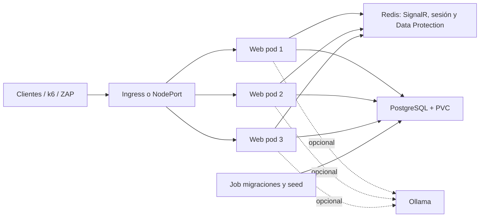

# EmprendeMarket distribuido

Aplicación ASP.NET Core 8 MVC con PostgreSQL, Identity, Redis, SignalR y Ollama opcional.
El despliegue principal usa Kubernetes local (Docker Desktop o kind) con tres réplicas web.

## Arquitectura



## Requisitos

- Docker Desktop con Kubernetes habilitado, o kind.
- `kubectl`, Docker y PowerShell.
- .NET 8 SDK para ejecutar localmente.
- k6 para carga; SonarQube y ZAP son opcionales.

## Ejecución local

```powershell
docker compose up -d db redis
dotnet restore
dotnet run
```

Sin Redis la aplicación usa caché de sesión y claves de Data Protection locales. Con Redis,
`Redis__ConnectionString` activa el backplane SignalR y el almacenamiento compartido.

## Kubernetes

1. Construir y cargar la imagen:

   ```powershell
   .\scripts\build-and-load.ps1 -Cluster docker-desktop
   # Para kind: .\scripts\build-and-load.ps1 -Cluster kind -KindCluster kind
   ```

2. Desplegar PostgreSQL, Redis, el Job de migraciones y tres réplicas web:

   ```powershell
   .\scripts\deploy.ps1
   ```

   El script toma `EMPRENDEMARKET_POSTGRES_PASSWORD`,
   `EMPRENDEMARKET_CONNECTION_STRING` y `EMPRENDEMARKET_REDIS_CONNECTION` del entorno.
   Ollama es opcional: `.\scripts\deploy.ps1 -IncludeOllama`.

3. Abrir `http://localhost:30080` o usar `kubectl port-forward -n emprendermarket svc/emprendemarket-web 8080:80`.
   El Ingress requiere instalar previamente ingress-nginx y se habilita con
   `kubectl apply -f k8s/32-ingress.yaml`.

## Tiempo real

Abrir `/Tiempo-Real` en dos navegadores. El cliente reconecta automáticamente, muestra los
eventos y la instancia emisora, y permite simular un evento solo en Development. Para grupos,
el hub expone `UnirseComoEmprendedor` y `UnirseComoCliente`; la lógica de negocio permanece en
`INotificacionService`.

## Pruebas

```powershell
.\tests\k6\run-in-cluster.ps1 -Vus 10 -Duration 30s
.\tests\k6\availability-check.ps1 -BaseUrl http://localhost:8090
.\scripts\resilience-test.ps1
.\scripts\network-test.ps1 -Profile baseline
.\scripts\network-test.ps1 -Profile delay-loss -Delay 100ms -Loss 5%
docker compose -f tools/sonarqube/docker-compose.yml up -d
.\scripts\sonar-scan.ps1
.\scripts\zap-baseline.ps1
```

Para red, consultar [docs/red.md](docs/red.md). La lista de capturas para el informe está
en [docs/EVIDENCIAS.md](docs/EVIDENCIAS.md).

## Estructura relevante

`Hubs/` y `Services/` contienen tiempo real; `k8s/` los manifiestos numerados; `scripts/` la
automatización; `tests/k6/` las pruebas; `tools/` SonarQube; `evidencias/` resultados locales.
Las configuraciones de Swarm se conservan como legado para no romper flujos existentes.
